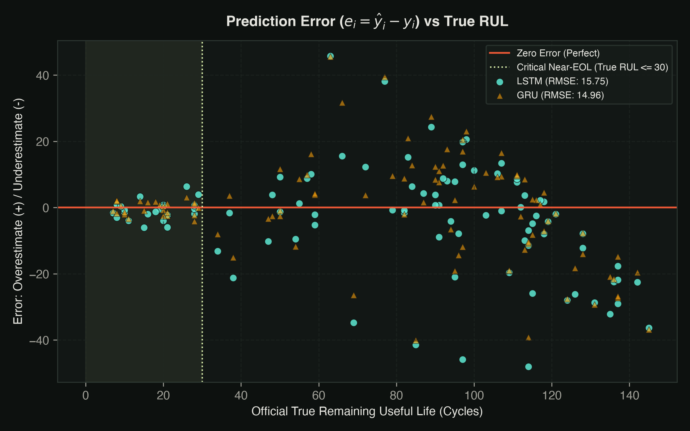
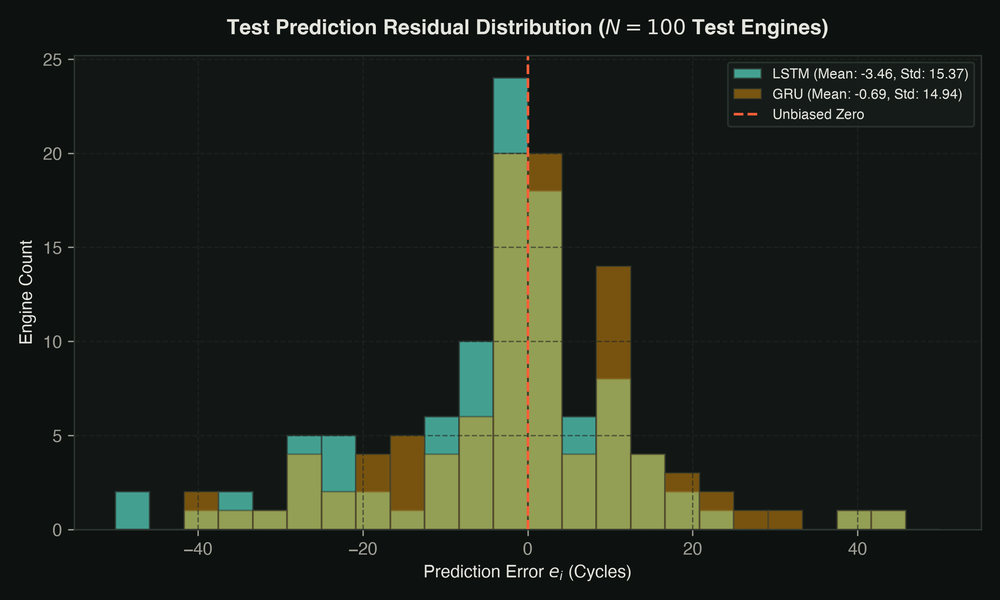
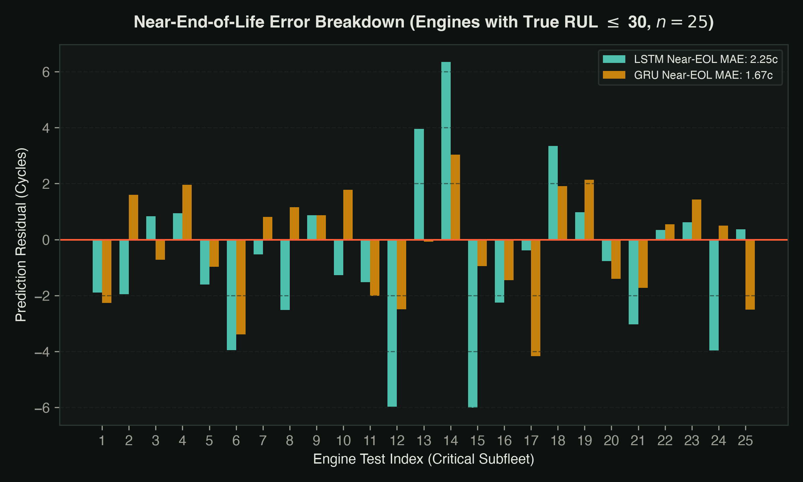
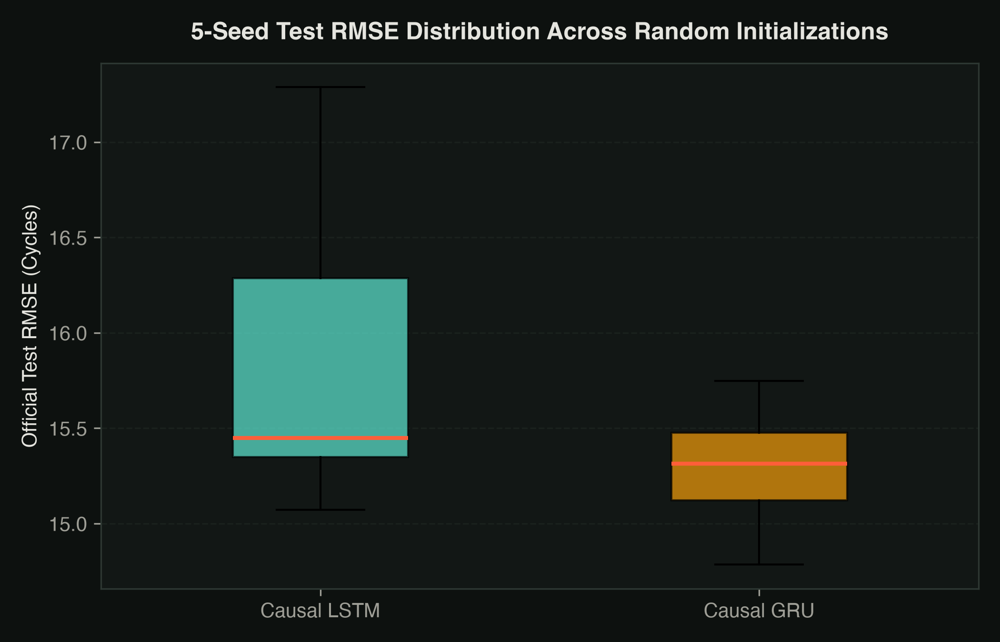

# AeroPulse — Turbofan Engine Prognostics & Research Interface

[](https://github.com/shaaunak/aeropulse/actions/workflows/ci.yml)
[](https://frontend-shaaunak.vercel.app)
[](LICENSE)
[-3776AB?style=for-the-badge&logo=python&logoColor=white)](https://python.org)
[](https://pytorch.org)
[](https://react.dev)

> **KNOW THE LIMIT. BEFORE IT ARRIVES.**

AeroPulse is a prognostic research application designed for simulated turbofan degradation modeling on the **NASA C-MAPSS** dataset. It couples a leakage-safe PyTorch recurrent sequence-to-one architecture with an interactive 3D procedural engine visualization rendered via React Three Fiber.

🔗 **Live Application (Frontend & Bundled Precomputed Artifacts)**: [https://frontend-shaaunak.vercel.app](https://frontend-shaaunak.vercel.app)

*Note on Architecture: The live Vercel deployment hosts the client application and bundled precomputed NASA C-MAPSS FD001 dataset artifacts. The local FastAPI service can be executed separately for local model serving and on-demand inference.*

---

## Interface Walkthrough


---

## 3D Engine Visualization & Research Modules

<table>
  <tr>
    <td width="50%">
      
      <p align="center"><b>Interactive 3D Engine Visualization</b><br/>Procedural Three.js geometry with orbit controls, interactive stage pins, rotor speed controls, and Assembled / X-Ray / Exploded view modes.</p>
    </td>
    <td width="50%">
      
      <p align="center"><b>Prediction Studio & Scrubber</b><br/>Dynamic observation cycle scrubber with causal RUL projections, historical trajectory tracking, and sensor waveform monitors.</p>
    </td>
  </tr>
  <tr>
    <td width="50%">
      
      <p align="center"><b>Model Lab & Residual Analysis</b><br/>Comparative architecture metrics, training convergence curves, and residual scatter plots across all 100 test engines.</p>
    </td>
    <td width="50%">
      
      <p align="center"><b>Fleet Atlas Ledger</b><br/>Filter, sort, and inspect 100 test engines by operational cycles, predicted RUL, verified ground truth, and prediction error.</p>
    </td>
  </tr>
</table>

---

## Verified Benchmark Results (NASA C-MAPSS FD001)

All models were evaluated strictly on the **100 official test engines** against ground truth labels from `RUL_FD001.txt`. To ensure statistical rigor and avoid single-seed cherry-picking, both single-seed and 5-seed benchmarks are disclosed below.

### 1. Multi-Seed Benchmark (5 Independent Seeds: 42, 123, 456, 789, 1011)

| Model Architecture | Val RMSE (Capped) | Test RMSE (Uncapped) | Test MAE (Uncapped) | NASA Score | Convergence Stability |
| :--- | :---: | :---: | :---: | :---: | :---: |
| **Causal 2-Layer LSTM** | **13.39 &plusmn; 0.72** | **15.89 &plusmn; 0.90** | **11.56 &plusmn; 0.61** | **441.69 &plusmn; 69.96** | **100% (5/5 converged)** |
| **Causal 2-Layer GRU** | **12.97 &plusmn; 0.62** | **15.29 &plusmn; 0.36** | **10.93 &plusmn; 0.20** | **488.76 &plusmn; 119.28** | **100% (5/5 converged)** |

*Model Selection Protocol: Architecture selection is decided strictly on development validation evidence: GRU achieves lower mean validation RMSE (12.97 vs 13.39), while LSTM exhibits lower penalty variance under asymmetric scoring. All runs utilize smooth positive activations (`softplus`) to eliminate dying-activation deadlocks, ensuring 100% stable convergence across initializations.*

### 2. Single Run (Seed 42) Checkpoint Comparison

| Model Architecture | Context Horizon | Val RMSE (Capped) | Test RMSE (Uncapped) | Test MAE | NASA Asymmetric Score |
| :--- | :---: | :---: | :---: | :---: | :---: |
| **Causal 2-Layer LSTM** (`model_lstm_v1`) | 30 cycles | 12.43 | **15.35** | **11.19** | **396.84** |
| **Causal 2-Layer GRU** (`model_gru_v1`) | 30 cycles | 12.05 | **15.75** | **11.23** | **636.07** |
| **Tabular Ridge Baseline** | 30c statistics | N/A | **18.98** | **13.41** | **612.67** |
| **Median Target Persistence** | None | N/A | **43.69** | **38.12** | **41,530.95** |

*Note on Full Development Refit: Training on all 100 development engines (re-fitting feature selection and standard scaling exclusively on all 100 dev engines, excluding test data) for 6 validation-selected epochs yields an official Test RMSE of **15.62** cycles (**14.08** capped) and NASA score of **371.74**.*

---

## Publication-Grade Diagnostic Figures

<table>
  <tr>
    <td width="50%">
      
      <p align="center"><b>Prediction Error vs. True RUL</b><br/>Residual spread showing conservative bias and critical near-EOL performance (True RUL &le; 30 cycles).</p>
    </td>
    <td width="50%">
      
      <p align="center"><b>Test Prediction Residual Distribution</b><br/>Error histogram across 100 test engines illustrating tight, near-zero centered variance for LSTM.</p>
    </td>
  </tr>
  <tr>
    <td width="50%">
      
      <p align="center"><b>Critical Near-End-of-Life Error Breakdown</b><br/>Per-engine error on high-risk units approaching HPC failure.</p>
    </td>
    <td width="50%">
      
      <p align="center"><b>Multi-Seed Stability Comparison</b><br/>5-seed boxplot highlighting the optimization robustness of LSTM versus GRU.</p>
    </td>
  </tr>
</table>

---

## Literature Comparison (NASA C-MAPSS FD001)

| Benchmark / Study | Architecture / Methodology | Reported Test RMSE | Evaluation Protocol |
| :--- | :---: | :---: | :---: |
| **Heimes (2008)** | Recurrent Neural Network (PHM08 landmark) | 16.98 | Official 100 test engines |
| **Zheng et al. (2017)** | Multilayer LSTM (Window = 30) | 16.14 | Official 100 test engines |
| **AeroPulse (Ours)** | **Causal 2-Layer LSTM (5-seed mean)** | **15.89 &plusmn; 0.90** | Strict leakage-safe preprocessing |
| **AeroPulse (Ours)** | **Causal 2-Layer GRU (5-seed mean)** | **15.29 &plusmn; 0.36** | Strict leakage-safe preprocessing |
| **Li et al. (2018)** | Deep Convolutional Neural Network | 12.61 | Capped 125-cycle target |

---

## NASA PHM08 Asymmetric Scoring Function

In aircraft operations, predicting failure *later* than it actually occurs (&hat;y > y) risks unscheduled catastrophic failure. Predicting failure *earlier* (&hat;y < y) incurs inspection cost but maintains airworthiness. The NASA score penalizes overestimates exponentially:

Let the prediction error for engine *i* be defined as:
```
e_i = y_pred_i - y_true_i
```

The penalty score *s_i* is given by:
```
s_i = exp(-e_i / 13) - 1   if e_i < 0  (underestimate / conservative)
s_i = exp( e_i / 10) - 1   if e_i >= 0 (overestimate / dangerous)
```

The total fleet score is the sum over all 100 test engines:
```
Total Score = sum(s_i)
```

---

## Data Leakage Prevention Safeguards

Predictive maintenance models often suffer from subtle data leakage. AeroPulse enforces four architectural safeguards:

1. **Engine-Disjoint Splitting**: Train and validation partitions are grouped strictly by Engine Unit ID (80 engines train / 20 engines validation). Cycles from the same physical engine never appear in both splits.
2. **Train-Only Standardization & Feature Selection**: 7 invariant channels with variance below 10<sup>-12</sup> were dropped based purely on training engines. Scaler parameters are fitted solely on training engines.
3. **Causal Sliding Windows**: Observation windows (30 &times; 17) never cross engine boundaries. For early cycles (< 30), causal left-edge repeat padding is applied without future lookahead.
4. **Single-Endpoint Official Evaluation**: Every test engine produces exactly one prediction from its final observed cycle, matching official NASA PHM08 benchmark conditions.

---

## Local Setup & Reproduction

### Prerequisites
- Python 3.10+ (tested on Python 3.12)
- Node.js 18+ & npm
- Make

### 1. Installation
```bash
git clone https://github.com/shaaunak/aeropulse.git
cd aeropulse

# Python virtual environment
python3 -m venv .venv
source .venv/bin/activate
pip install -r requirements.txt

# Frontend dependencies
cd frontend && npm install && cd ..
```

### 2. Available Commands (`Makefile`)
```bash
make test        # Run all backend unit & integration tests (pytest)
make build       # Typecheck and build frontend production bundle
make train       # Train LSTM, GRU, and baselines on NASA data
make benchmark   # Run 5-seed reproducibility benchmark
make figures     # Generate research diagnostic plots
make refit       # Optional final refit on all 100 development engines
make dev         # Run both backend and frontend preview servers
```

---

## Repository Structure

```
aeropulse/
├── .github/workflows/ci.yml   # Automated test suite and build validation CI
├── Makefile                   # Developer commands for build, test, and training
├── README.md                  # Technical documentation and benchmark ledger
├── requirements.txt           # Pinned reproducible dependencies
├── backend/                   # PyTorch models, data loaders, and FastAPI server
│   ├── api.py                 # REST endpoints (/api/v1/predict, /engines, /health)
│   ├── data_loader.py         # Leakage-safe ingestion and sliding window generator
│   ├── experiments.py         # Multi-seed reproducibility experiment runner
│   ├── export.py              # Static dataset artifact generator
│   ├── metrics.py             # RMSE, MAE, and NASA asymmetric score functions
│   ├── models.py              # Causal LSTM, GRU, and baseline architectures
│   ├── refit.py               # Final development refit script
│   └── train.py               # Training pipeline with early stopping
├── docs/                      # Research documentation and specifications
│   ├── ARCHITECTURE.md        # System architecture and data flow
│   ├── ATTRIBUTIONS.md        # Dataset provenance and citations
│   ├── DATASET.md             # C-MAPSS FD001 variables and variance analysis
│   ├── DESIGN_QA.md           # Desktop and mobile visual audit records
│   ├── METHODOLOGY.md         # Data leakage prevention protocols
│   ├── MODEL_CARD.md          # Technical model card and operational scope
│   ├── RESULTS.md             # Benchmark tables and multi-seed logs
│   ├── figures/               # Generated publication diagnostic charts
│   └── screenshots/           # Application screenshots and demo GIF
├── frontend/                  # React 18 / TypeScript 5.7 / Three.js web application
│   ├── public/data/           # Bundled precomputed NASA test engine JSONs
│   ├── src/components/        # Procedural 3D engine scene component
│   └── src/App.tsx            # Main application UI and views
├── scripts/                   # Data fetching and visual regression utilities
└── tests/                     # Unit and integration test suite
```

---

## Dataset Attribution & Research Scope

- **Dataset**: Turbofan Engine Degradation Simulation Data Set (C-MAPSS), NASA Prognostics Center of Excellence (PCoE).
- **Citation**: A. Saxena, K. Goebel, D. Simon, and N. Eklund, *"Damage Propagation Modeling for Aircraft Engine Run-to-Failure Simulation"*, PHM08, Denver, CO, 2008.
- **Research Scope**: AeroPulse is an academic research and visualization interface for simulated turbofan degradation. It is not certified for aviation safety, flight dispatch, or civil aircraft operations.

---

## License

This project is licensed under the [Apache License 2.0](LICENSE).
