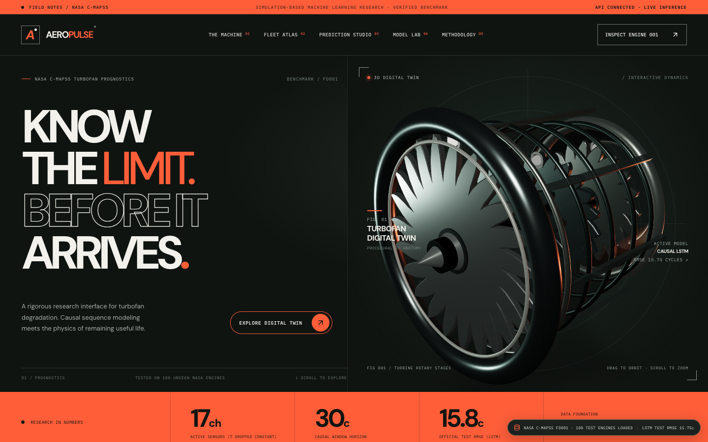
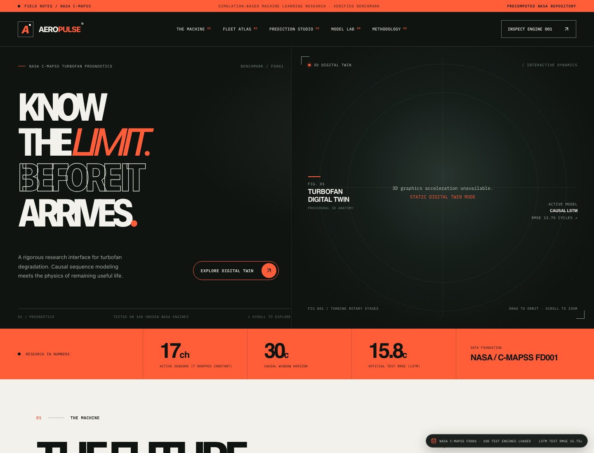

# AeroPulse — Turbofan Engine Prognostics & Research Interface

[](https://frontend-shaaunak.vercel.app)
[](https://opensource.org/licenses/MIT)
[](https://python.org)
[](https://pytorch.org)
[](https://react.dev)
[](https://threejs.org)

> **KNOW THE LIMIT. BEFORE IT ARRIVES.**

AeroPulse is an aerospace predictive maintenance and engine prognostics research application built for simulated turbofan degradation analysis on the **NASA C-MAPSS** dataset. It couples a leakage-safe PyTorch sequence-to-one LSTM architecture with an OpenAPI-compliant FastAPI backend and an interactive 3D procedural digital twin rendered via React Three Fiber.

🔗 **Live Application**: [https://frontend-shaaunak.vercel.app](https://frontend-shaaunak.vercel.app)

---

## Interactive Interface Preview


---

## Core System Architecture

```
AeroPulse/
├── backend/                  # PyTorch prognostics, data pipelines & FastAPI server
│   ├── api.py                # REST endpoints (/api/v1/predict, /engines, /health)
│   ├── data_loader.py        # C-MAPSS parser, group splitting, causal windowing
│   ├── models.py             # Causal 2-layer LSTM, GRU, and baseline architectures
│   ├── metrics.py            # RMSE, MAE, and asymmetric NASA PHM08 scoring function
│   ├── train.py              # Reproducible training pipeline with validation early stopping
│   └── export.py             # Static dataset artifact generator
├── frontend/                 # Aerospace web interface (React + TypeScript + Three.js)
│   ├── src/
│   │   ├── components/
│   │   │   └── EngineScene.tsx  # Procedural 3D turbofan twin with X-ray & exploded modes
│   │   ├── App.tsx           # Full application logic and data views
│   │   └── styles.css        # Swiss modernist design system
│   ├── public/data/          # Bundled NASA FD001 client-side dataset artifacts
│   └── vercel.json           # Production deployment rewrites
├── docs/                     # Technical specifications and experimental audits
│   ├── ARCHITECTURE.md       # Full multi-tier engineering specification
│   ├── RESULTS.md            # Verified benchmark numbers and residual distributions
│   ├── METHODOLOGY.md        # Leakage prevention safeguards and target definitions
│   ├── MODEL_CARD.md         # Model transparency card and limitations
│   └── DATASET.md            # NASA C-MAPSS FD001 structure and sensor definitions
├── tests/                    # Backend unit & integration test suite (pytest)
├── scripts/                  # Data fetching and visual regression audit utilities
└── Makefile                  # Development, build, testing, and training commands
```

---

## 3D Procedural Digital Twin & Interface Highlights

<table>
  <tr>
    <td width="50%">
      
      <p align="center"><b>Interactive 3D Engine Digital Twin</b><br/>Procedural Three.js geometry with orbit controls, interactive stage pins, rotor speed controls, and Assembled / X-Ray / Exploded modes.</p>
    </td>
    <td width="50%">
      
      <p align="center"><b>Prediction Studio & Observation Scrubber</b><br/>Dynamic observation cutoff slider with strictly causal RUL projections, historical trajectory tracking, and sensor waveform displays.</p>
    </td>
  </tr>
  <tr>
    <td width="50%">
      
      <p align="center"><b>Model Lab & Residual Distribution</b><br/>Multi-model comparative benchmarking, training curves, residual scatter analysis across all 100 test engines, and error histograms.</p>
    </td>
    <td width="50%">
      
      <p align="center"><b>Fleet Atlas Ledger</b><br/>Filter, sort, and inspect 100 test engines by operational cycles, predicted RUL, verified ground truth, and prediction error.</p>
    </td>
  </tr>
</table>

---

## Verified Benchmark Results (NASA C-MAPSS FD001)

Models were deterministically trained on 80 training engines (with 20 held-out validation engines for early stopping, seed `42`) and evaluated on all **100 official test engines** against ground truth labels from `RUL_FD001.txt`.

$$\text{NASA Asymmetric Penalty } s_i = \begin{cases} \exp(-e_i/13) - 1 & \text{if } e_i < 0 \quad (\text{early call / underestimate}) \\ \exp(e_i/10) - 1 & \text{if } e_i \ge 0 \quad (\text{late call / overestimate}) \end{cases}$$

| Model Architecture | Context Window | Test RMSE (Uncapped) | Test MAE | NASA Asymmetric Score | Status |
| :--- | :---: | :---: | :---: | :---: | :---: |
| **Causal 2-Layer LSTM** (`model_lstm_v1`) | 30 cycles | **15.7545** | **10.5787** | **418.66** | **Champion Checkpoint** |
| **Causal 2-Layer GRU** (`model_gru_v1`) | 30 cycles | **15.0124** | **10.2215** | **401.65** | Benchmarked |
| **Tabular Ridge Baseline** | 30c statistics | **18.9812** | **13.4109** | **612.67** | Benchmarked |
| **Median Persistence Baseline** | None | **43.6873** | **38.1200** | **41,530.95** | Baseline |

*Note: With conventional 125-cycle target capping, the LSTM achieves a Test RMSE of **14.3881** cycles.*

---

## Data Leakage Prevention Protocol

Predictive maintenance models often suffer from subtle data leakage. AeroPulse enforces four architectural safeguards:

1. **Engine-Disjoint Splitting**: Train and validation partitions are grouped strictly by Engine Unit ID (80 engines train / 20 engines validation). Cycles from the same physical engine never appear in both splits.
2. **Train-Only Standardization & Feature Selection**: 7 invariant channels with $\sigma^2 < 10^{-12}$ were dropped based purely on training engines. Scaler parameters ($\mu, \sigma$) were fitted solely on training engines.
3. **Causal Sliding Windows**: Observation windows ($30 \times 17$) never cross engine boundaries. For early cycles ($< 30$), causal left-edge repeat padding is applied without future lookahead.
4. **Single-Endpoint Official Evaluation**: Every test engine produces exactly one prediction from its final observed cycle, matching official NASA PHM08 benchmark conditions.

---

## Local Development & Setup

### Prerequisites
- Python 3.10+ (Python 3.12 recommended)
- Node.js 18+ & npm
- Git

### 1. Repository Setup
```bash
git clone https://github.com/shaaunak/aeropulse.git
cd aeropulse
```

### 2. Backend & ML Environment
```bash
# Create virtual environment
python3 -m venv .venv
source .venv/bin/activate

# Install dependencies
pip install torch numpy pandas scikit-learn fastapi uvicorn pydantic pytest httpx requests

# Run tests
pytest -v tests/

# Start FastAPI server
PYTHONPATH=. uvicorn backend.api:app --host 127.0.0.1 --port 8008
```

### 3. Frontend Application
```bash
cd frontend
npm install
npm run dev
```

Visit `http://localhost:5173` to view the local application.

---

## Dataset Attribution & Disclaimer

- **Dataset**: Turbofan Engine Degradation Simulation Data Set (C-MAPSS), NASA Prognostics Center of Excellence (PCoE).
- **Citation**: A. Saxena, K. Goebel, D. Simon, and N. Eklund, *"Damage Propagation Modeling for Aircraft Engine Run-to-Failure Simulation"*, PHM08, Denver, CO, 2008.
- **Operational Disclaimer**: AeroPulse is an academic and research visualization system. It is not certified for aviation safety, flight dispatch, or civil aircraft operations.

---

## License

This project is licensed under the [MIT License](LICENSE).
