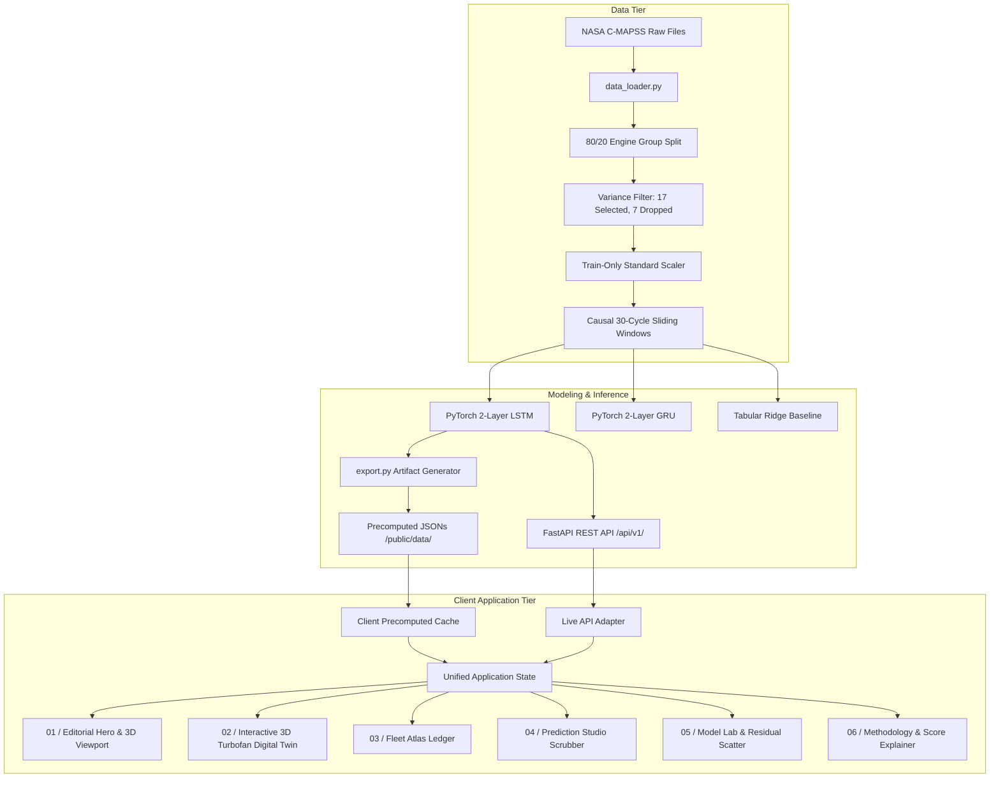

# AeroPulse System Architecture & Technical Specifications

## 1. System Overview

AeroPulse is architected in two decoupled, independently deployable tiers:
1. **Computational Prognostics Engine (Backend)**: Python 3.12, PyTorch 2.15, Scikit-learn, FastAPI, Pydantic v2.
2. **Aerospace Research Interface (Frontend)**: React 18, TypeScript 5.7, Vite 6, React Three Fiber 8, Three.js r173, Lucide Icons.

---

## 2. Backend Design (`backend/`)

- **`data_loader.py`**:
  - Validates shape integrity (26 columns: unit, cycle, 3 settings, 21 sensors).
  - Enforces deterministic 80/20 train/validation split by unit ID (seed 42).
  - Fits variance threshold ($10^{-12}$) and `StandardScaler` strictly on training engines.
  - Constructs intra-engine causal sliding windows ($B \times 30 \times 17$) with left-edge repeat padding for sequence heads.
  - Extracts official test windows from the final observed cycles of 100 test engines.

- **`models.py`**:
  - `TurbofanLSTM`: 2-layer sequence-to-one LSTM (hidden dim 64, dropout 0.20, linear projection head 64 -> 32 -> 1, clamp $\ge 0$).
  - `TurbofanGRU`: 2-layer recurrent GRU comparison model.
  - `TabularRidgeBaseline`: Ridge regression fit on 102 engineered summary features (last, mean, std, min, max, trend across 17 channels).
  - `PersistenceBaseline`: Median training target baseline.

- **`metrics.py`**:
  - Root Mean Squared Error (RMSE)
  - Mean Absolute Error (MAE)
  - NASA Asymmetric Scoring function ($e_i < 0 \implies \exp(-e_i/13)-1$; $e_i \ge 0 \implies \exp(e_i/10)-1$).

- **`api.py`**:
  - OpenAPI 3.0 REST endpoints conforming to `specs/API_AND_EXPORT_SCHEMA.md`:
    - `GET /api/v1/health`
    - `GET /api/v1/datasets`
    - `GET /api/v1/engines?subset=FD001&split=test`
    - `GET /api/v1/engines/{unit_id}?subset=FD001&split=test`
    - `GET /api/v1/engines/{unit_id}/history?model_id=...`
    - `GET /api/v1/experiments`
    - `POST /api/v1/predict` (rejects lookahead queries exceeding available cycles).

---

## 3. Frontend Design (`frontend/`)

- **Design System & Styling**:
  - Swiss modernist layout with industrial monospace instrumentation typography.
  - Obsidian (`#101411`) and Drafting Paper (`#F3F1EB`) theme transitions with Signal Vermilion (`#FF5E39`) accents.
  - Zero heavy component UI libraries: deliberate, fast, high-performance CSS.

- **3D Digital Twin (`EngineScene.tsx`)**:
  - Procedural Three.js geometry with realistic blade aerodynamics, bypass lip, concentric compressor stages, rotor shaft, and rear exhaust.
  - Viewport modes: `ASSEMBLED`, `XRAY` (semi-transparent casing), and `EXPLODED` (axial stage separation).
  - Interactive 3D pins on Fan, Compressor, Casing, Turbine, and Nozzle with aerodynamic descriptions and illustrative sensor mappings.
  - DPR clamping (`[1, 1.7]`) and `IntersectionObserver` lazy mounting for GPU efficiency.
  - Graceful static fallback when WebGL is unavailable.

- **Data Dual-Mode Protocol**:
  - Client automatically probes `/api/v1/health`.
  - If backend is active: live inference API is queried.
  - If backend is offline: seamlessly falls back to precomputed NASA dataset JSON artifacts stored in `/public/data/` without UI interruption.
